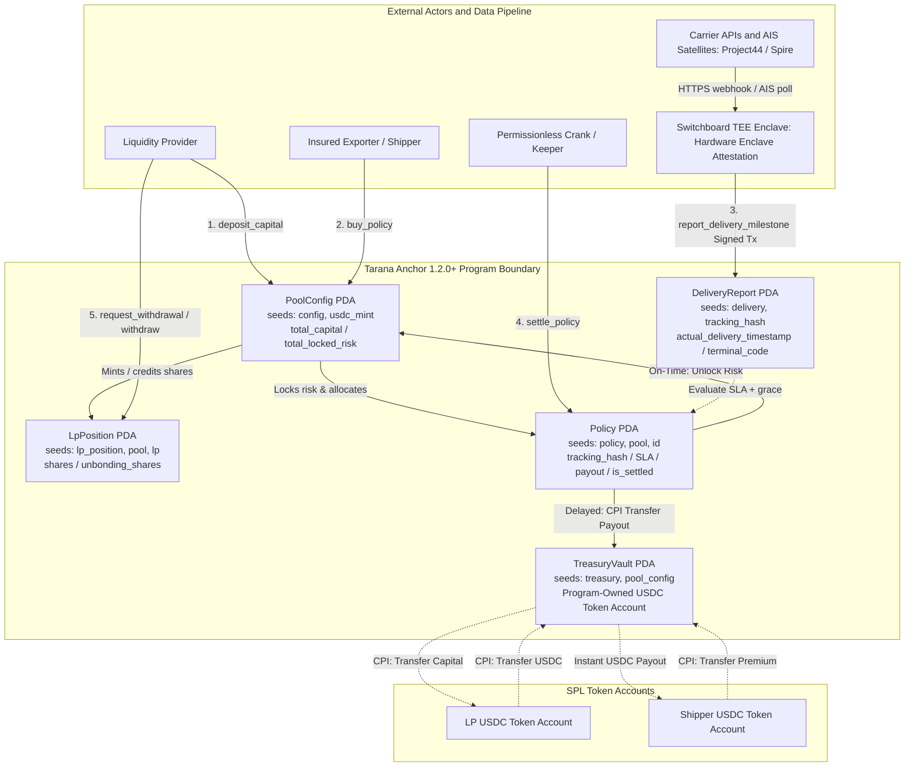
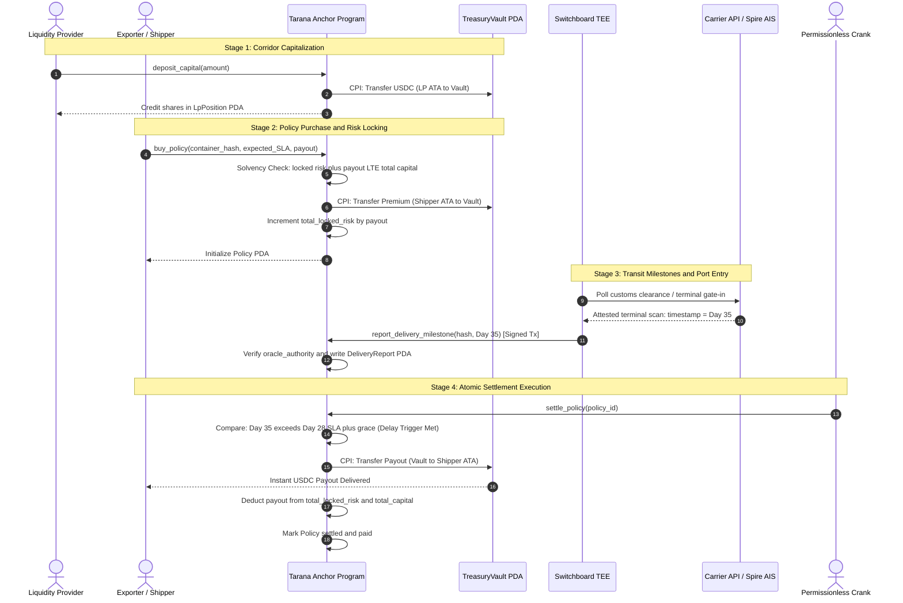

# Turbin3 Capstone Deliverable 1: Letter of Intent (LOI) & On-Chain Use Cases
## Project: Tarana Protocol (Parametric Freight Delay Indemnity on Solana)

**Author:** 0xgsvs (Venkat Subrahmanyam) — Turbin3 Q3 2026 Solana Builder  
**Category:** Real World Assets (RWAs) / Structured Credit & Supply-Chain Underwriting  
**Framework:** [Solana Anchor 1.2.0+](https://www.anchor-lang.com/)  

---

# Part 1: Final Project Proposal & LOI

## 1. High-Level Concept Overview (2–5 Sentences)
**Tarana Protocol** (Sanskrit: तरण (*taraṇa*) — safe crossing over waters, transit passage, deliverance from peril) is a decentralized parametric freight delay insurance protocol built on Solana using Anchor 1.2.0+. It enables cross-border e-commerce exporters and freight forwarders to purchase programmatic delay hedges that automatically trigger instant USDC liquidity payouts when cargo transit violates agreed Service Level Agreement (SLA) delivery timestamps. Global liquidity providers underwrite high-turnover shipping corridors in exchange for real-yield premiums, with solvency mathematically guaranteed on-chain through fully collateralized vaults. By replacing 45-day paper claims adjusters with atomic smart-contract execution triggered by verified carrier tracking and maritime AIS transponders, Tarana restores working capital for global trade operators.

---

## 2. Core Value Proposition & Product-Market Fit (PMF)

### 2.1 Synthesized Value Proposition
Cross-border exporters and direct-to-consumer (D2C) brands lose billions annually to shipping delays, where port bottlenecks and route diversions delay shipments by weeks, triggering marketplace stockouts, Amazon Buy Box suspensions, and acute working-capital lockups (*UNCTAD Review of Maritime Transport*). Standard marine cargo insurance structurally excludes transit delay under the globally standard *Institute Cargo Clauses (Clause 4.5)*, covering only physical hull loss or damage, while traditional commercial delay riders require 30 to 60 days of manual claims paperwork. Tarana provides autonomous on-chain delay indemnity: shippers pay micro-premiums in USDC per container or Bill of Lading (BOL) into a program vault, while verified oracles ([Project44](https://www.project44.com/) and [Spire Maritime AIS](https://spire.com/maritime/)) attest delivery milestones on-chain. Upon verified SLA breach past a grace window, Tarana executes an atomic sub-second USDC payout directly to the shipper’s wallet. This eliminates claims disputes, restores cashflow instantly, and provides Solana liquidity providers with a 12–15% annualized real yield across high-velocity 20–35 day capital turnover cycles ([Flexport Ocean Timeliness Indicator](https://www.flexport.com/research/ocean-timeliness-indicator/)).

### 2.2 Coverage Check & Value Drivers
- **Coverage of the Excluded Delay Gap:** Fills the uncollateralized risk gap left by standard marine cargo policies that legally reject transit delay claims.
- **High Capital Velocity:** Unlike 1-year private credit or seasonal 6-month farm pools, ocean voyages turnover every [20 to 35 days](https://www.flexport.com/research/ocean-timeliness-indicator/), enabling LPs to compound premiums 8–10x per year.
- **Multi-Source Oracle Verification:** Cross-verifies carrier API events against independent [Spire Satellite AIS Transponders](https://spire.com/maritime/) to eliminate single-carrier reporting tampering.
- **Embedded B2B Distribution:** Integrates into 3PL portals and freight quotation engines as an embedded 1-click checkout add-on.

---

## 3. Target Markets & User Profiles

### 3.1 Target Market Segments
1. **Cross-Border E-Commerce Exporters (Shopify / Amazon Global Sellers):** Over $780B in cross-border e-commerce GMV; delayed ocean containers cause inventory stockouts and merchant penalties.
2. **Digital Freight Forwarders & 3PLs:** Over $1.1T global freight forwarding sector; forwarders offer Tarana as an embedded "Guaranteed Arrival Shield" to boost client retention.
3. **Short-Cycle DeFi Liquidity Providers:** Stablecoin capital seeking uncorrelated real yields with rapid monthly liquidity recycling.

### 3.2 Key User Profiles
- **Profile 1 (Buyer): Rohan Mehra, Co-founder of a Cross-Border Apparel Brand (Surat to US).**
  - *Problem:* Ships 40-foot ocean containers (quoted 28-day transit). Port congestion pushes transit to 40 days, causing Amazon inventory stockout costing $3,000/day.
  - *Workflow:* Pays 200 USDC premium at export booking to secure a 4,000 USDC delay policy (SLA: 28 days + 5 days grace).
  - *Outcome:* Container still at sea on Day 34; Tarana triggers instant 4,000 USDC payout, funding emergency air freight replenishment immediately.
- **Profile 2 (Underwriter): Marcus Bennett, Quant Credit Fund Manager.**
  - *Problem:* Seeks diversified, high-velocity real yields without 12-month lockups.
  - *Workflow:* Deposits 500,000 USDC into Tarana's Transpacific Underwriting Pool with a 7-day unbonding cooldown.
  - *Outcome:* Earns 13.8% annualized net APY with capital recycling every 28 days.

---

## 4. Competitor Landscape

| Competitor | Platform | Model | Strengths | Critical Vulnerabilities / Gaps |
|---|---|---|---|---|
| **[Etherisc](https://github.com/etherisc)** | Ethereum / Gnosis | Passenger flight delay dApp | Early pioneer; proven parametric flight smart contracts | B2C consumer passenger focus; high L1 gas fees; zero maritime freight integration |
| **Parsyl** | Lloyd's Syndicate / Off-chain | Perishable cold-chain IoT cargo insurance | Deep maritime underwriting; IoT sensor hardware integration | High minimum premiums ($10,000+); manual 30-day claims payout |
| **[Arbol](https://www.arbol.io/)** | Avalanche / Base | Institutional climate & weather risk | $1B+ in parametric contracts; strong balance sheet | Strictly weather-focused; does not track port terminals or shipping SLAs |
| **TradeLens** | Hyperledger (Defunct) | IBM/Maersk logistics consortium | Backed by largest ocean shipping carriers | Failed due to closed consortium trust issues and zero crypto liquidity |
| **Tarana Protocol** | Solana (Anchor 1.2.0+) | Autonomous parametric freight delay indemnity | Sub-second settlement; sub-cent fees; short 25-day capital cycles | Early-stage oracle crank; requires freight forwarder distribution integrations |

---

## 5. Founder-Market Fit (FMF)
- **Technical Capabilities:** 0xgsvs is a Turbin3 Q3 2026 Solana engineer with hands-on Anchor 1.2.0+, LiteSVM testing, and custom PDA vault experience.
- **Domain Context:** Based in India (+05:30), adjacent to major export corridors (JNPT Nhava Sheva, Mundra Port) connecting Indian manufacturing with the Middle East, Europe, and North America.
- **Logistics Integration:** Experience integrating tracking webhooks and container milestone schemas with satellite AIS feeds ([Spire Maritime](https://spire.com/maritime/)).

---

## 6. Actors & Protocol Roles
- **Direct Actors (Signers):** Insured Shipper (`buy_policy`), Liquidity Provider (`deposit_capital`, `withdraw_capital`), Oracle Crank (`report_delivery_milestone`).
- **Beneficiaries:** Downstream retail customers (receive faster stock replenishment via liquidity-funded air freight).
- **Administrators:** Protocol Governance Multisig (`initialize_pool`, set supported corridors and fee bps).
- **Stakeholders:** Solana DeFi ecosystem (continuous high-turnover real yield).

---

## 7. Anchor 1.2.0+ Architecture & Workflow Diagrams

### 7.1 Program Account Architecture

### 7.2 End-to-End Workflow Sequence

### 7.3 Anchor 1.2.0+ Use Cases (One Case = One Instruction Handler)

1. **`initialize_pool`**: Admin initializes `PoolConfig` PDA, sets max grace period, defines oracle authority, and creates `TreasuryVault` PDA token account.
2. **`deposit_capital`**: LP transfers USDC into `TreasuryVault` via SPL Token CPI. Program mints pool shares into `LpPosition` PDA and increments `total_capital`.
3. **`buy_policy`**: Shipper transfers USDC premium to `TreasuryVault`. Program verifies solvency (`total_capital - total_locked_risk >= payout_amount`), locks payout risk, and creates `Policy` PDA with tracking hash and SLA delivery timestamp.
4. **`report_delivery_milestone`**: Verified oracle crank ([Switchboard TEE](https://docs.switchboard.xyz/)) writes carrier delivery or terminal gate-in timestamp into `DeliveryReport` PDA.
5. **`settle_policy`**: Permissionless instruction callable after SLA + grace period. Evaluates actual arrival vs SLA:
   - *Delayed:* CPI transfers `payout_amount` from `TreasuryVault` to shipper; decrements `total_locked_risk` and `total_capital`.
   - *On-Time:* Unlocks `payout_amount` from `total_locked_risk` back into unallocated pool capital.
6. **`request_withdrawal`**: LP initiates unbonding cooldown (7 days) in `LpPosition` PDA to prevent bank runs during reported port strikes.
7. **`withdraw_capital`**: LP redeems matured unbonded shares for USDC from unencumbered capital.

---

## 8. On-Chain Reference Matrix

| Account Struct | PDA Seeds | Owner | Key Fields |
|---|---|---|---|
| `PoolConfig` | `[b"config", usdc_mint]` | Tarana Program | `admin`, `oracle_authority`, `total_capital`, `total_locked_risk`, `fee_bps` |
| `TreasuryVault` | `[b"treasury", pool_config]` | SPL Token Program | USDC token account owned by `PoolConfig` PDA |
| `Policy` | `[b"policy", pool_config, policy_id]` | Tarana Program | `shipper`, `tracking_hash`, `expected_delivery`, `grace_period`, `payout_amount`, `is_settled` |
| `LpPosition` | `[b"lp_position", pool_config, lp]` | Tarana Program | `lp`, `shares`, `unbonding_shares`, `unbonding_timestamp` |
| `DeliveryReport` | `[b"delivery", tracking_hash]` | Tarana Program | `tracking_hash`, `actual_delivery`, `terminal_code`, `attested_at`, `reporter` |

---
---

# Part 2: Process Appendix (Red Team Log)

### 1. Initial Draft vs. Red Team Attack & Resolution

| Topic | Raw Initial Assumption | AI Red Team Attack Point | Accepted / Rejected & Strategic Fix |
|---|---|---|---|
| **User Target** | Retail e-commerce shoppers buying $10 insurance for sneaker shipments. | **Invalid Buyer:** Retail shoppers expect free shipping/returns and file chargebacks; they do not buy delivery insurance. | **ACCEPTED:** Shifted 100% to B2B exporters and freight forwarders where delays trigger real working-capital and inventory loss. |
| **Claim Logic** | Require carrier to admit fault for shipping delay. | **Legal Loophole:** Ocean bills of lading contain broad Force Majeure clauses disclaiming carrier delay liability. | **ACCEPTED:** Protocol is 100% objective parametric: only checks verified SLA delivery timestamp vs threshold. Zero fault investigation. |
| **Correlated Risk** | Assumed shipping delays are random independent events. | **Choke-Point Correlation:** Red Sea or Panama Canal blockages delay entire corridors simultaneously. | **ACCEPTED:** Program enforces 100% full collateralization (`total_locked_risk <= total_capital`) plus corridor exposure caps. |
| **Oracle Security** | Single centralized Node.js script polling carrier APIs. | **Single Point of Failure:** Single script can be manipulated, go offline, or run out of SOL. | **ACCEPTED:** Production uses [Switchboard TEE Functions](https://docs.switchboard.xyz/) cross-referencing [Spire Maritime AIS](https://spire.com/maritime/) satellite data. Settlement is permissionless. |

---

## 2. Verification Sign-Off Sources
- **Maritime Transit Volatility Data:** [Flexport Ocean Timeliness Indicator (OTI)](https://www.flexport.com/research/ocean-timeliness-indicator/).
- **Container Freight Rate Benchmarks:** [Freightos Baltic Index (FBX)](https://fbx.freightos.com/).
- **Maritime Satellite Telematics:** [Spire Global Maritime AIS Tracking](https://spire.com/maritime/).
- **Logistics Decision Intelligence:** [Project44 Movement Platform](https://www.project44.com/).
- **On-Chain Framework & Oracles:** [Solana Anchor Framework](https://www.anchor-lang.com/) and [Switchboard Oracle Documentation](https://docs.switchboard.xyz/).
- **Maritime Insurance Legal Standard:** Institute Cargo Clauses (A) 2009, Clause 4.5 (*Exclusion of loss, damage or expense caused by delay*).
