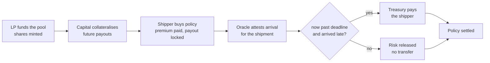

# Overview

Freight Delay is a parametric freight-delay indemnity protocol on Solana. Exporters and
freight forwarders buy USDC-settled hedges against a shipment arriving past its
quoted delivery time; liquidity providers underwrite that risk for premium yield;
a single oracle authority attests deliveries; and settlement is permissionless.

The mechanism is deliberately small: **six instructions, four account types, and
one invariant.**

## The problem it targets

An exporter shipping on a quoted 28-day ocean transit is short a specific risk: a
port bottleneck or route diversion that pushes arrival out by a week or two,
triggering marketplace stockouts and a working-capital lockup at exactly the
moment cash is tightest. Standard marine cargo cover is the wrong shape for it —
it responds to physical loss, not to the schedule — and a paper delay claim is
paid weeks later, after manual assessment.

Freight Delay moves that risk to a balance sheet that wants it. Shippers buy a payout
that triggers on a measured arrival timestamp, not on an assessed loss, so there
is no adjuster, no claim file, and no dispute window — the attested arrival either
crosses the deadline or it does not.

## Mechanism in one pass



Four properties fall out of that flow, and the rest of this documentation is
about how they are enforced rather than merely intended:

**Premiums are paid up front and in full.** `buy_policy` transfers the premium
before any state is written, so an underfunded buyer cannot end up holding a
live policy.

**The payout is collateralised before the policy exists.** `buy_policy` refuses
to lock a payout larger than the pool's unencumbered capital, so the pool cannot
sell a liability it cannot honour.

**Settlement reads one number.** The trigger is
`actual_delivery > expected_delivery + grace_period`, evaluated at settlement time
against an oracle-attested account. No discretion is exercised by the crank.

**The crank is untrusted.** Anyone can call `settle_policy`, and the outcome is
fully determined by on-chain state. The crank supplies compute, not judgement.

## What a policy is

A `Policy` is a fixed contract between the pool and one shipper:

| Term | Field | Meaning |
|---|---|---|
| Shipment | `shipment_id` | Which bill of lading the delivery feed tracks |
| SLA | `expected_delivery` | The quoted arrival timestamp |
| Slack | `grace_period` | Allowed lateness before a payout fires |
| Payout | `payout_amount` | USDC paid on trigger, locked as risk at purchase |
| Cost | `premium_amount` | USDC paid up front, of which a fee is taken |

`actual_delivery > expected_delivery + grace_period` is the entire trigger
condition. A policy written with a deadline so far out that no voyage can breach
it can never pay out, and the program accepts it: validating that a quoted SLA is
actuarially sensible is out of scope.

## Where the money lives

All pool USDC sits in a single token account — the treasury — whose authority is
the `PoolConfig` PDA. The program cannot move it except through
`transfer_from_treasury`, which produces the PDA's seeds during a CPI. There is
no admin key that can drain the treasury.

A useful identity to hold onto, since the accounting is split across two fields:

```text
treasury token balance = total_capital + total_fees
```

`total_capital` backs LP shares and policy payouts; `total_fees` accumulates
protocol fees, which are excluded from LP claims and — as of this program — have
no withdrawal path.

## Read next

- [Scope & Status](/freight_delay/introduction/scope) — what exists in this repository, and what does not
- [Architecture](/freight_delay/protocol/architecture) — account graph and PDA derivation
- [Pool Lifecycle](/freight_delay/workflows/lifecycle) — the same flow, instruction by instruction
