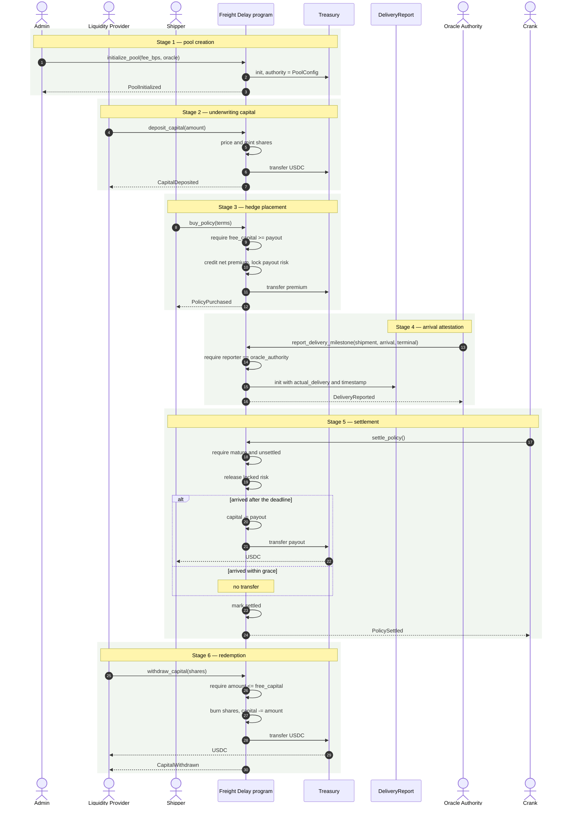
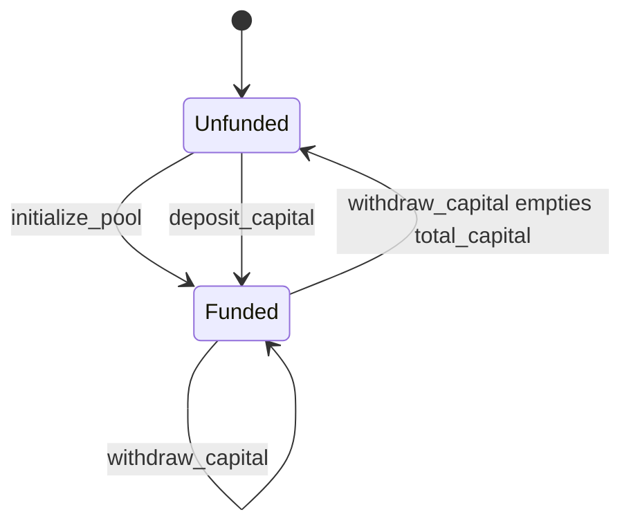
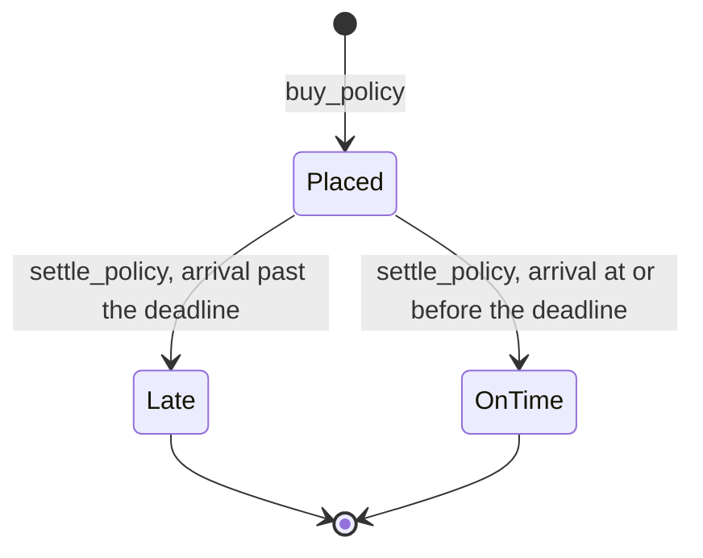
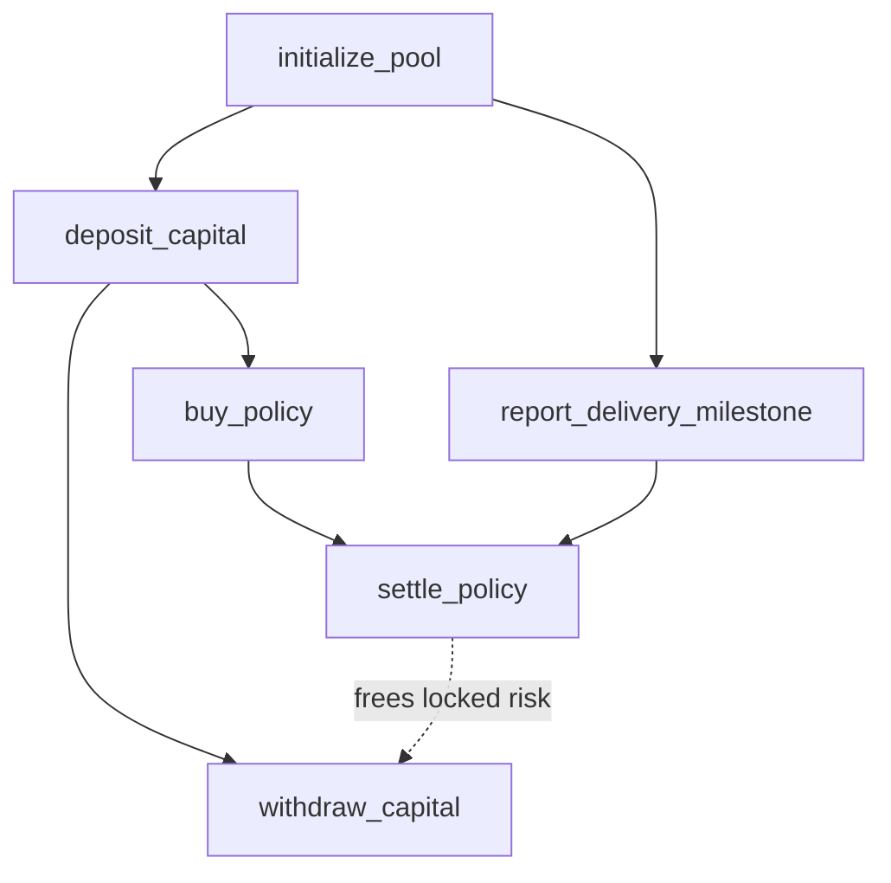

# Pool Lifecycle

The whole protocol, from initialisation to settlement, in the order it happens.

## End-to-end sequence

Stages 2 and 3 can interleave freely: policies can be sold the moment the pool
holds capital, and more capital can arrive while policies are live. Stage 4 must
precede stage 5 for a given `shipment_id` — `settle_policy` requires the
`DeliveryReport` account to exist, and there is no fallback if it does not.

## Pool state machine

`report_delivery_milestone` is deliberately absent from this diagram: it creates a
`DeliveryReport` and cannot move pool accounting at all — `config` is not even
`mut` in its account list, so it only reads `oracle_authority` to authorise the
caller.

There is no terminal or frozen state. The pool has no pause, no shutdown, and no
migration path; it is a permanent state machine.

## Policy state machine

`Late` and `OnTime` are both terminal, distinguished by the `is_paid` flag.
`Placed` is terminal in practice for any policy whose shipment is never attested:
`settle_policy` needs the `DeliveryReport` account to exist, so the transition
never becomes available.

## Instruction dependency graph

Read the dotted edge as the only coupling between settlement and redemption:
`settle_policy` lowers `total_locked_risk`, which raises `free_capital`, which is
the ceiling on `withdraw_capital`. Until policies settle, LP capital is not fully
withdrawable.

## Next

- [Instructions](/freight_delay/protocol/instructions) — the guards at each step
- [Invariants](/freight_delay/protocol/invariants) — what settlement must preserve
